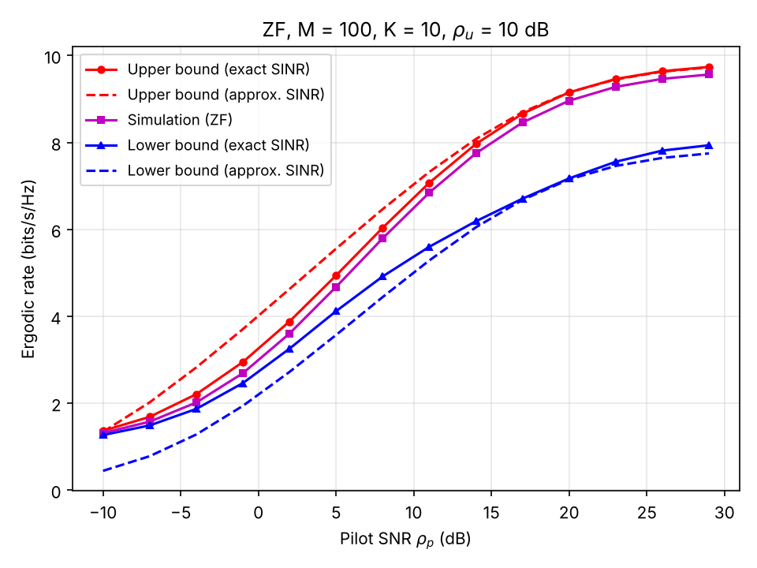
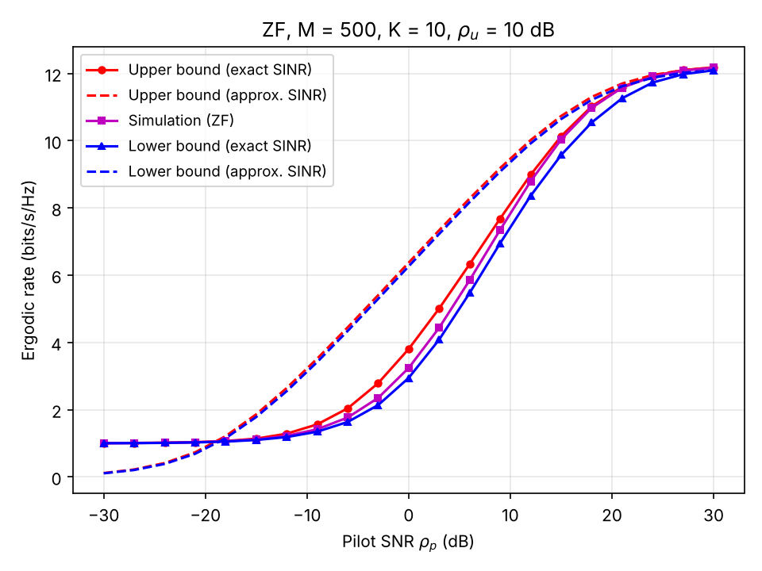
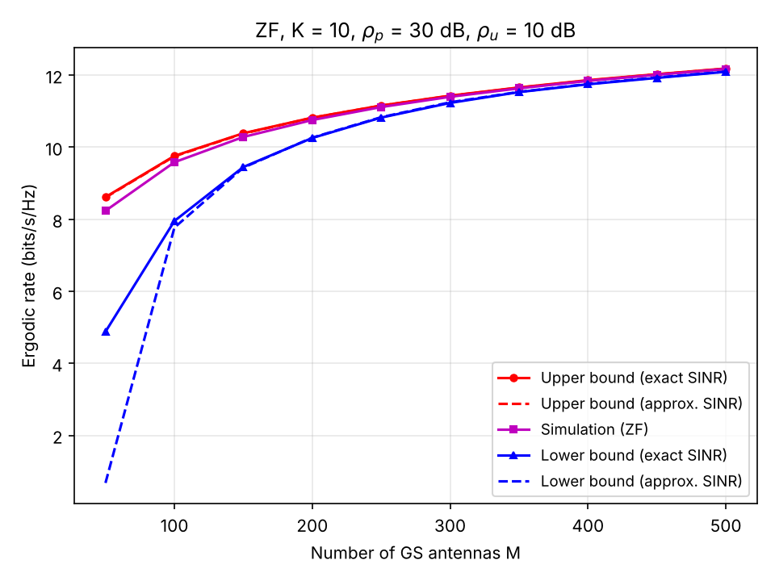
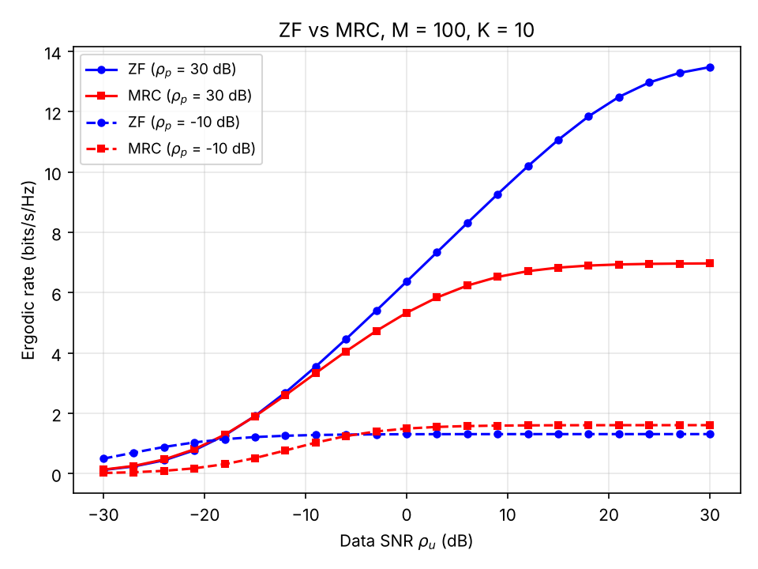

# Massive MIMO Drone Communications – Zero-Forcing Receiver

Simulation code for uplink **massive MIMO communications between a multi-antenna
ground station (GS) and multiple drones (UAVs)**, comparing the **Zero-Forcing
(ZF)** and **Maximum-Ratio Combining (MRC)** receivers under imperfect channel
state information (SPAWC 2018).

Author of the original MATLAB code: Prabhu Chandhar, Chandhar Research Labs, Chennai, India.

The repository contains both the original MATLAB scripts and an equivalent,
vectorised Python implementation.

## Repository layout

| Path | Description |
|------|-------------|
| `SPAWC2018_ZF.m` | MATLAB main script – generates Figures 1a, 1b, 2, 3 |
| `Calc_SPAWC2018` | MATLAB function computing SINR / rate statistics (save as `Calc_SPAWC2018.m` to run in MATLAB) |
| `python/mimo_drone_zf.py` | Python port of `Calc_SPAWC2018` (channel model, ZF/MRC, bounds) |
| `python/run_figures.py` | Python port of `SPAWC2018_ZF.m` – produces all figures |
| `figures/` | Figures generated by the Python code |
| `requirements.txt` | Python dependencies |

## System model

* **Ground station:** ULA with *M* antennas, half-wavelength spacing, carrier *f* = 2.5 GHz.
* **Drones:** *K* = 10 single-antenna drones dropped uniformly at random in a sphere of radius 500 m around the GS.
* **Channel:** pure line-of-sight with free-space path loss
  β<sub>k</sub> = (λ / 4π d<sub>k</sub>)² and a spherical-wavefront (near-field) phase across the array:

  g<sub>k</sub>[m] = √β<sub>k</sub> · exp(−j2π/λ · (d<sub>k</sub> + (mδ)²/(2d<sub>k</sub>) − mδ sinθ<sub>k</sub>cosφ<sub>k</sub>))

* **Power control:** channel inversion, p<sub>k</sub> = ρ<sub>u</sub>/β<sub>k</sub>, so every drone is received with data SNR ρ<sub>u</sub>.
* **Channel estimation:** pilot-based, Ĝ = G + W/√p<sub>p</sub>, with pilot power set from the pilot SNR ρ<sub>p</sub> at the 500 m cell edge.
* **Receivers:** ZF (Ĝ<sup>†</sup> = (Ĝ<sup>H</sup>Ĝ)<sup>−1</sup>Ĝ<sup>H</sup>) and MRC (Ĝ<sup>H</sup>).

For ZF the code evaluates the ergodic rate by Monte-Carlo simulation and two
Jensen-type bounds:

* Upper bound: log₂(1 + E[SINR])
* Lower bound: log₂(1 + 1/E[1/SINR])

each using either the *exact* (Monte-Carlo) effective-noise variance or the
closed-form *approximation*
E[zz<sup>H</sup>] ≈ (1 + Σp<sub>k</sub>/p<sub>p</sub> + tr((G<sup>H</sup>G)<sup>−1</sup>)/p<sub>p</sub>)(G<sup>H</sup>G)<sup>−1</sup>.

## Running the Python code

```bash
pip install -r requirements.txt
cd python
python run_figures.py                 # full run: 1000 drops × 200 noise realisations (~50 min on 2 cores)
python run_figures.py --quick         # quick preview: 50 × 100
python run_figures.py --figs 1a,2     # only some figures (run subsets in parallel to use more cores)
python run_figures.py --drops 200 --noise 300 --seed 7 --out ../figures   # MATLAB's original settings
```

Using the core function directly:

```python
import numpy as np
from mimo_drone_zf import C, calc_spawc2018

lam = C / 2.5e9
pu_p = 10**(30/10) * (4*np.pi*500/lam)**2      # 30 dB pilot SNR at the cell edge
r = calc_spawc2018(M=100, K=10, delta=lam/2, lam=lam, pu_p=pu_p, rhou=10)
print(r.rate_zf, r.rate_mrc, r.rate_ub_exact, r.rate_lb_exact)
```

## Results

The figures below were generated with `python run_figures.py` (1000 drone drops × 200
noise/estimation-error realisations per point, seed 2018).

**Smooth curves (common random numbers).** Every point on every curve is evaluated with the
same seed, and drone positions and noise come from separate random streams. All points
therefore see exactly the same 1000 drone geometries, even when *M* changes. Without this,
each point draws its own drops. The lower bound E[1/SINR] is heavy-tailed: it is dominated by
rare drops where two drones are almost aligned and G<sup>H</sup>G is nearly singular. So
whether a point happens to sample such a drop makes the curve jump up and down, even with many
more iterations.

### Figure 1a – ZF ergodic rate vs pilot SNR (M = 100)


### Figure 1b – ZF ergodic rate vs pilot SNR (M = 500)


Observations:

* The rate increases with pilot SNR and saturates once channel-estimation error
  becomes negligible (≈ 9.5 bits/s/Hz for M = 100, ≈ 12 bits/s/Hz for M = 500).
* The **upper bound** log₂(1 + E[SINR]) is tight for all pilot SNRs.
* With **M = 100** the **lower bound** is noticeably loose (≈ 1.5–2 bits/s/Hz below the
  simulation at high pilot SNR). This is because E[1/SINR] is dominated by the rare
  ill-conditioned drone geometries described above.
* With **M = 500** the array resolves the drones much better. Both exact bounds then hug the
  simulation. The closed-form approximation is accurate above roughly 15 dB pilot SNR but
  is optimistic at low pilot SNR, where the estimation error is no longer small.

### Figure 2 – ZF ergodic rate vs number of GS antennas


The rate grows with *M* because of the array gain. The upper bound (exact and approximate)
is tight for every *M*. The lower bound converges to the simulated rate only for large arrays
(M ≳ 300), again because of ill-conditioned drone geometries at small *M*.

### Figure 3 – ZF vs MRC


* **Good CSI (ρ<sub>p</sub> = 30 dB):** ZF and MRC match at low data SNR (noise-limited).
  MRC then saturates at about 6–7 bits/s/Hz because of inter-drone interference. ZF keeps
  increasing, reaching about 13 bits/s/Hz at 30 dB.
* **Poor CSI (ρ<sub>p</sub> = −10 dB):** both receivers are limited by channel-estimation
  error and flatten out below about 2 bits/s/Hz. ZF is slightly better at very low data SNR,
  and MRC is slightly better at higher data SNR.

## Notes on the Python port

* The inner noise realisations are vectorised with batched NumPy linear algebra,
  so the Python version is considerably faster than the loop-based MATLAB code.
* In the MATLAB MRC noise term, `G_est(:,lp_k)` is evaluated after the interference
  loop, so it uses drone *K*'s estimate instead of drone 1's. The Python port uses
  drone 1's combiner (`G_est(:,1)`), which is what the SINR of drone 1 requires.
* The fifth legend entry in the MATLAB plots is labelled "Upper bound (Approximate-SINR)"
  but is actually the approximate *lower* bound; the Python figures label it correctly.
